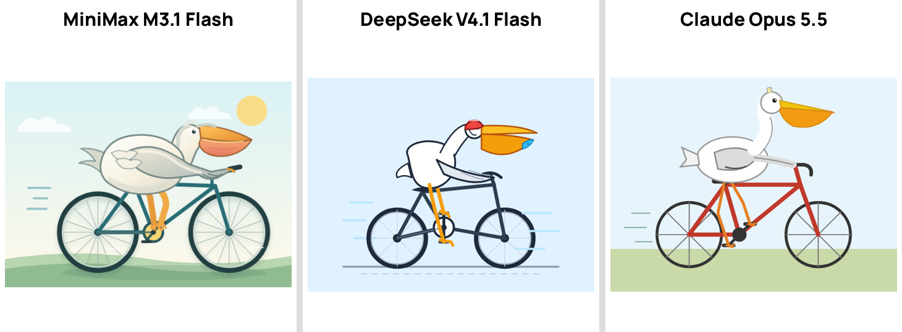
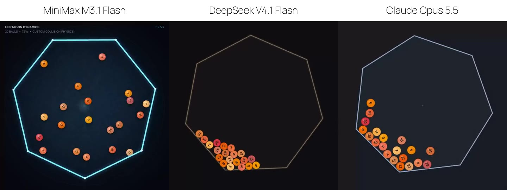

# llm-hype-tests

Два популярных «вирусных» теста для нейросетей: **20 мячей в крутящемся семиугольнике** (физика с нуля в одном HTML) и **пеликан на велосипеде** в SVG. Проверяли новую **MiniMax M3.1 Flash** (вышла 19 октября 2026) против **DeepSeek V4.1 Flash 1017** — у них одинаковая цена, $0,15 / $0,60 за 1M токенов — и **Claude Opus 5.5** как эталон. У всех уровень размышлений medium, один прогон.

**Смотреть и запускать в браузере:** https://neurostack-lab.github.io/llm-hype-tests/

## Коротко

- Пеликан: самая проработанная картинка у MiniMax M3.1 Flash — небо, солнце, облака, тени.
- Семиугольник: оформление эффектнее всех у MiniMax, но мячи прыгают бесконечно — при каждом касании пола код сам подбрасывает мяч, чтобы выполнить условие «отскок выше радиуса мяча». У DeepSeek и Opus мячи затухают и ложатся внизу.
- Время на семиугольник: MiniMax 147 с, DeepSeek 45 с, Opus 89 с. На пеликана: 33 с, 21 с и 21 с.
- Цена семиугольника по прайсу: MiniMax ≈ $0,011, DeepSeek ≈ $0,007 (списание OpenRouter), Opus ≈ $0,14 (по прайсу $20 за 1M выходных токенов) — примерно в 14 раз дороже.

## Пеликан на велосипеде

## 20 мячей в крутящемся семиугольнике

Ролик: [media/heptagon.mp4](media/heptagon.mp4). Открыть каждую страницу: [MiniMax](heptagon/minimax.html) · [DeepSeek](heptagon/deepseek.html) · [Opus](heptagon/opus.html).

## Замеры

| | MiniMax M3.1 Flash | DeepSeek V4.1 Flash 1017 | Claude Opus 5.5 |
|---|---|---|---|
| Семиугольник: время | 147 с | 45 с | 89 с |
| Семиугольник: выходные токены | 17 550 | 13 783 | 7 161 |
| Пеликан: время | 33 с | 21 с | 21 с |
| Пеликан: выходные токены | 4 565 | 5 754 | 2 180 |
| Цена семиугольника | ≈ $0,011 по прайсу (сейчас бесплатно) | ≈ $0,007 | ≈ $0,14 |
| Мячи ложатся | нет, прыгают бесконечно | да | да |

Сырые данные: [results.json](results.json). Задания дословно: [prompt.md](prompt.md).

## Оговорки

Один прогон на модель, средний уровень размышлений (у MiniMax по умолчанию максимальный). Это быстрый тест, а не бенчмарк. Код из ответов не правили.

MIT. Канал: [@neurostack_news](https://t.me/neurostack_news)
