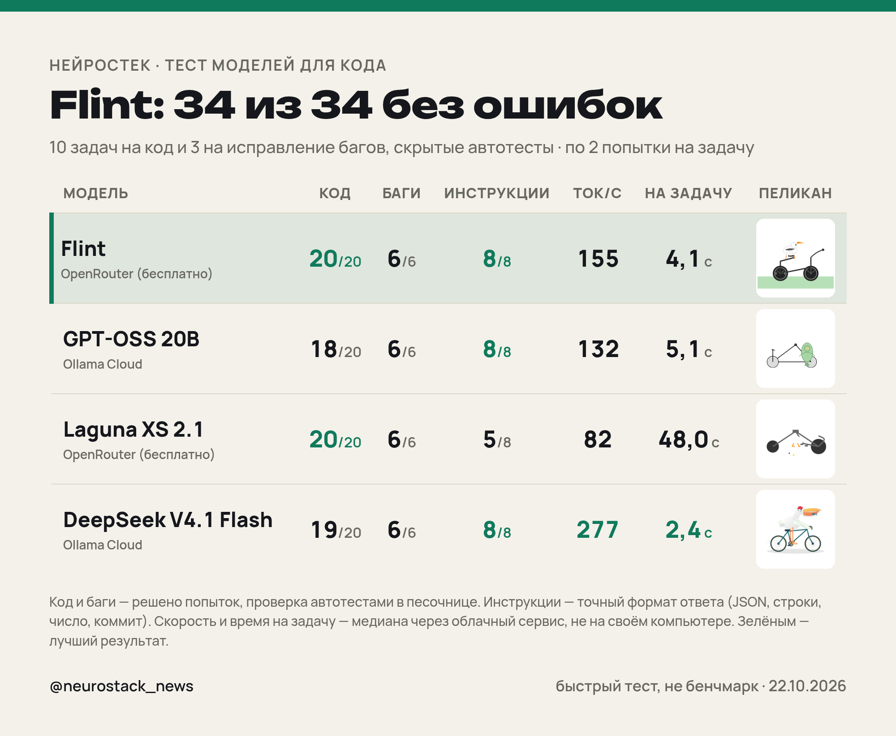
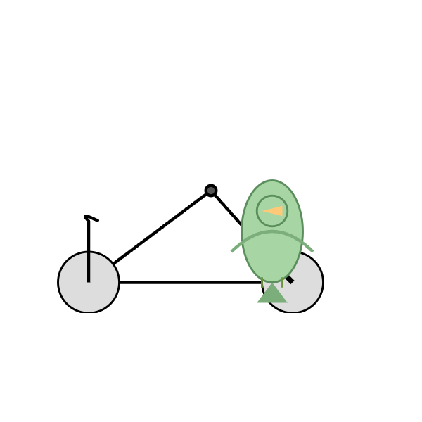
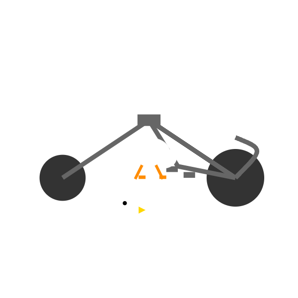
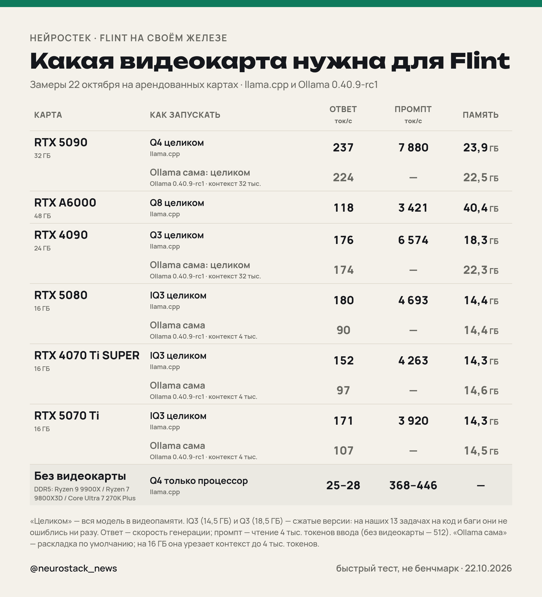

# Flint против соперников: тест на код и на своих видеокартах

Тест модели **Flint** от Recursive (открытая MoE: 39,8 млрд параметров, около 2,5 млрд активных, Apache 2.0) против моделей похожего класса: **GPT-OSS 20B**, **Laguna XS 2.1** (Poolside) и **DeepSeek V4.1 Flash** как эталон. 22 октября 2026.

## Коротко

- **Как тестировали:** 10 задач на код и 3 на исправление багов, по 2 попытки на задачу, ответы проверяли скрытыми автотестами в песочнице; плюс 4 задания на точный формат ответа, тоже по 2 попытки. Соперники Flint — GPT-OSS 20B, Laguna XS 2.1 и DeepSeek V4.1 Flash.
- **Flint — 34 из 34 без ошибок:** 20 из 20 попыток на код, 6 из 6 на исправление багов, 8 из 8 на точный формат ответа. Единственная модель в тесте без единой ошибки.
- **DeepSeek V4.1 Flash — 19 из 20** по коду (в одной попытке ушла в рассуждения и не дала кода), 6 из 6 по багам, 8 из 8 по формату. Самая быстрая: 277 ток/с и 2,4 с на задачу.
- **Laguna XS 2.1 — 20 из 20** по коду и 6 из 6 по багам, но **5 из 8** по формату и **48 с** на задачу (медиана) — почти в 12 раз дольше Flint.
- **GPT-OSS 20B — 18 из 20** по коду, 6 из 6 по багам, 8 из 8 по формату.
- **Минус Flint:** обычно **4,1 с** на задачу, но на одну ушло **96 с** — модель иногда долго думает.
- **Ollama:** для `ollama run flint` нужна **Ollama 0.40.9 или новее**. 22 октября 2026 это предрелиз **0.40.9-rc1**; стабильная **0.40.8** отвечает «model requires ollama version v0.40.9 or newer». С 0.40.9-rc1 модель (22 ГБ) работает целиком на видеокарте даже на RTX 4090 — 174 ток/с.

## Что проверяли

- **Код:** 10 практических задач (разбор длительности, слияние интервалов, LRU-кэш, частые слова, проверка IPv4, римские числа, «расплющивание» JSON, анаграммы, разбор строки CSV, следующий рабочий день). У каждой модели по 2 попытки на задачу, всего 20. Ответ засчитан, только если прошёл **все** скрытые автотесты, включая крайние случаи.
- **Исправление багов:** 3 функции с ошибками (бинарный поиск, скользящее среднее, изменяемый аргумент по умолчанию), по 2 попытки.
- **Инструкции:** 4 задания на точный формат ответа (чистый JSON, ровно 3 строки, одно число, коммит по правилам), по 2 попытки, проверка программой.
- **Наглядные:** пеликан на велосипеде (SVG) и 20 мячей в крутящемся семиугольнике (HTML) — по одной попытке, те же промпты, что в [тесте MiniMax](../README.md).

Все задания и скрытые проверки дословно: [tasks.md](tasks.md). Код из ответов выполнялся в изолированной песочнице без сети, с лимитом 5 с CPU и 1 ГБ памяти.

## Результаты

| | Flint | GPT-OSS 20B | Laguna XS 2.1 | DeepSeek V4.1 Flash |
|---|---|---|---|---|
| Код: решено попыток | **20/20** | **18/20** | **20/20** | **19/20** |
| Исправление багов | 6/6 | 6/6 | 6/6 | 6/6 |
| Инструкции (точный формат) | 8/8 | 8/8 | 5/8 | 8/8 |
| Скорость, ток/с (медиана) | 155 | 132 | 82 | 277 |
| Время на задачу, с (медиана / максимум) | 4,1 / 96 | 5,1 / 28 | 48,0 / 150 | 2,4 / 16 |
| Токенов на задачу (медиана, с рассуждениями) | 531 | 548 | 3 706 | 582 |
| Первый токен, с (медиана) | 0,50 | 0,45 | 0,29 | 0,46 |
| Пустых ответов | 0 | 0 | 1 | 1 |
| Где запускали | OpenRouter (бесплатно) | Ollama Cloud | OpenRouter (бесплатно) | Ollama Cloud |

Сырые данные: [results.json](results.json), ответы моделей целиком: [raw/](raw/).

### Где ошиблись

- **GPT-OSS 20B:** `code_flatten#0`; `code_roman#1`
- **DeepSeek V4.1 Flash:** `code_roman#1`

Причины по каждой ошибке (последние строки вывода автотеста) — в `results.json`, поле `fails`.

## Пеликан на велосипеде

   

## 20 мячей в семиугольнике

Открыть в браузере: [Flint](heptagon/flint.html) · [GPT-OSS 20B](heptagon/gptoss.html) · [DeepSeek V4.1 Flash](heptagon/deepseek.html). Ролик: [media/heptagon.mp4](media/heptagon.mp4).

## Flint на своей видеокарте

Замеры на шести видеокартах (RTX 5090, A6000, 4090, 5080, 4070 Ti SUPER, 5070 Ti) и без видеокарты, llama.cpp и Ollama: **[flint/gpu/](gpu/)**.

## Оговорки

- Быстрый тест, а не бенчмарк: 2 попытки на задачу, одна на наглядные.
- Flint и Laguna запускались через бесплатный OpenRouter, GPT-OSS и DeepSeek — через Ollama Cloud. Скорость и первый токен — это скорость этих сервисов, а не вашего компьютера; локально Flint весит 23 ГБ.
- Лимит ответа — 16 000 токенов для всех, рассуждения включены по умолчанию. Если модель потратила лимит на рассуждения и не дала кода, попытка не засчитана.
- 74,2% на SWE-bench Verified — цифра Recursive, мы её не перепроверяли.
